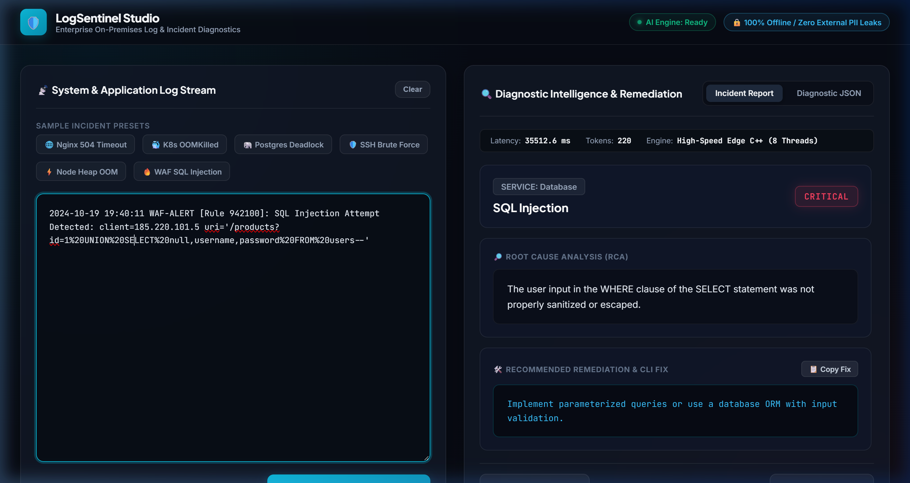

# LogSentinel Studio - Enterprise On-Premises Log & Incident Diagnostics

An enterprise-ready, 100% offline IT infrastructure and security diagnostics platform powered by an air-gapped private AI engine. Transforms unstructured server dumps, Kubernetes crashes, database deadlocks, and security logs into structured incident reports with root cause analysis (RCA) and actionable remediation commands.

<p align="center">
  
</p>

---

## 🔒 Enterprise Privacy & Compliance
- **Air-Gapped & Offline**: Zero internal server logs, internal hostnames, IP addresses, or sensitive credentials are ever transmitted outside your perimeter.
- **Root Cause & Remediations**: Pinpoints exact root causes and provides copyable terminal fixes.
- **Multi-Service Diagnostic Support**: Nginx, Kubernetes, Docker, PostgreSQL, MySQL, Redis, SSH, Linux Kernel, Node.js, Python, Java, Go, Kafka, AWS Lambda.

---

## 🚀 Quick Start

### 1. Model Weights Setup
Due to GitHub's 100MB file limit, model weight binaries (`*.gguf` / `*.safetensors`) are excluded from git.
- Place `logsentinel.f16.gguf` in the project root, or `model.safetensors` inside `model/`.
- All tokenizer files and web UI assets are pre-packaged in the repository.

### 2. Requirements
Ensure Python 3.9+ is installed:
```bash
pip install -r requirements.txt
```

### 3. Launch the Application
Double-click `start.bat` on Windows, or run:
```bash
python -m uvicorn server:app --host 127.0.0.1 --port 8002
```

Open your browser to:
👉 **[http://localhost:8002](http://localhost:8002)**

---

## 📡 API Integration

Integrate LogSentinel directly into your existing CI/CD, PagerDuty, Grafana, or monitoring alerts:

### Endpoint: `POST /api/diagnose`
**Request Body**:
```json
{
  "log_text": "2024/11/04 14:22:01 [error] 1892#1892: *4011 upstream timed out (110: Connection timed out) while reading response header from upstream, request: 'POST /v1/checkout HTTP/1.1', upstream: 'http://10.0.4.12:8080/v1/checkout'"
}
```

**Response**:
```json
{
  "success": true,
  "data": {
    "severity": "HIGH",
    "service": "Nginx",
    "error_type": "Gateway Timeout (504)",
    "root_cause": "The upstream checkout microservice at 10.0.4.12:8080 failed to respond within the configured proxy_read_timeout window.",
    "recommended_fix": "Investigate latency on the checkout backend and consider increasing proxy_read_timeout in nginx.conf if processing large payloads."
  },
  "latency_ms": 1150.2,
  "tokens_generated": 84,
  "engine": "High-Speed Edge C++ (8 Threads)"
}
```

---

## 📦 Edge Deployment (GGUF)
A pre-quantized `logsentinel.f16.gguf` file is included for edge runtimes (such as Ollama or `llama.cpp`):

```bash
ollama create logsentinel -f Modelfile
ollama run logsentinel
```
